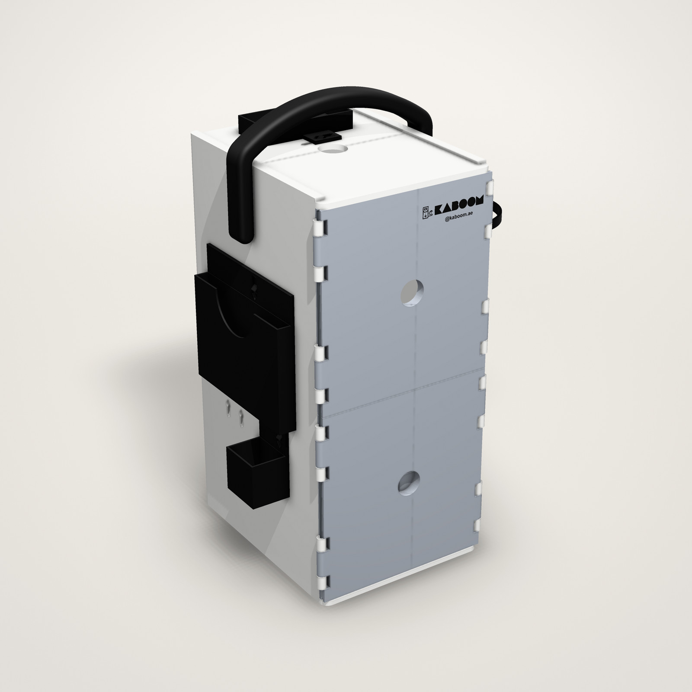
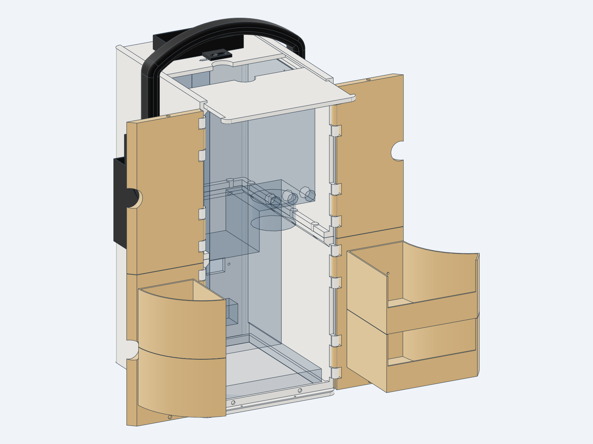
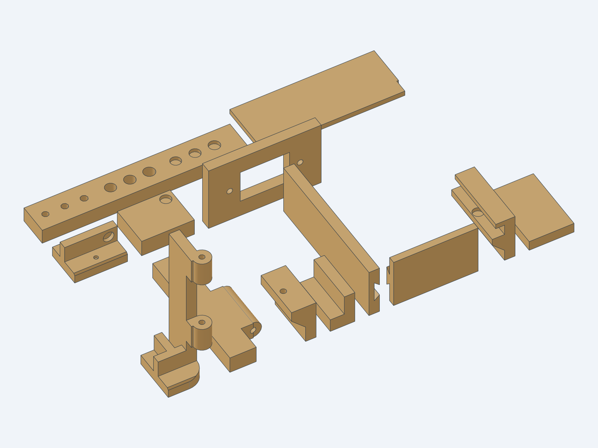
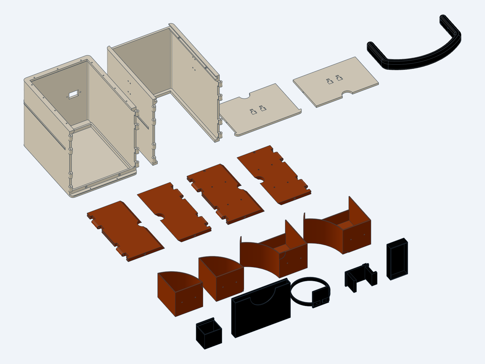
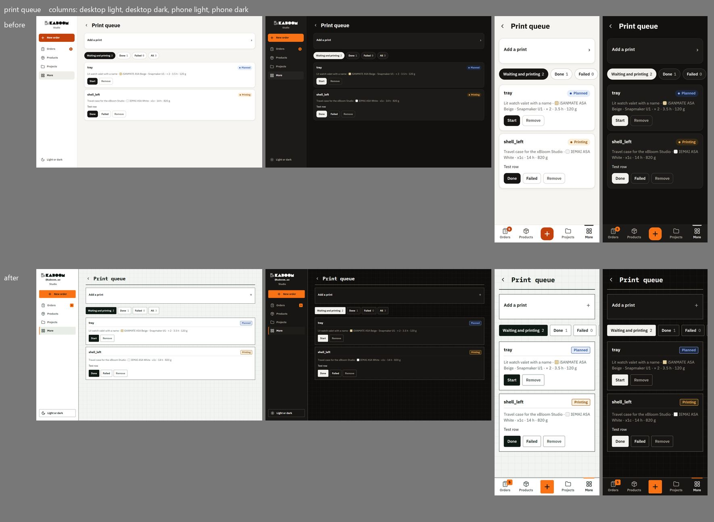

# KABOOM showcase

Selected work from **KABOOM** ([@kaboom.ae](https://instagram.com/kaboom.ae)), my 3D-printing studio in the UAE.

Every product starts as **parametric CAD written in Python**. The model is checked by code and fit-tested with small printed test pieces, then sliced, costed and printed. I build this with a team of AI coding agents: I set the design, the measurements and the rules, the agents write and run the code, and every part goes through automated checks before it reaches a printer.

This repo holds a few pieces of that pipeline. The full studio is private.

---

## 1. Custom name signs: English and Arabic

A made-to-order sign. A customer picks the name, font, icon and colours, and the studio produces a **ready-to-print multi-colour 3MF** with no manual CAD work.

- **Arabic done properly.** CAD tools can't lay out Arabic: the letters come out unjoined and left to right. [`studio-tools/outlines.py`](studio-tools/outlines.py) shapes text with **HarfBuzz** (the shaping engine browsers use) and extracts the real glyph outlines from the font file with fontTools, so Arabic is joined and right to left. It also flags strokes too thin to print.
- **Layout that adapts.** It shrinks the text or grows the plate (up to 250 mm), and warns if a name would get too small.
- **Hidden fixings.** Magnet pockets with relief tabs and keyholes are sized from measured test prints, not guessed.
- **Printer-ready output.** [`studio-tools/mc3mf.py`](studio-tools/mc3mf.py) writes one 3MF where each part is already assigned its filament, so it opens in the slicer with colours set. It refuses designs that need more than the printer's 4 colours.

Code: [`name-sign/src/sign_parts.py`](name-sign/src/sign_parts.py) builds the plate, border, raised text, icon and back.

## 2. Brew-in-the-box travel case (for the xBloom Studio coffee machine)

A fully 3D-printed case for a coffee machine. The machine travels standing up and brews without being taken out. It has 18 printed parts, hinged doors, a sliding lid, screw-on trays and a modular accessory mount, all printed in ASA and **without a single support**.

- **One source of truth.** Every dimension lives in [`travel_parts.py`](travel-case/src/travel_parts.py). Each printed part is a small script that builds from it, so changing one number rebuilds the whole case consistently.
- **Checks as code.** [`travel-case/checks/`](travel-case/checks) runs after every change and checks for parts that collide, clearances, whether the doors swing freely, whether hidden inserts and magnets are buried in enough plastic, whether parts fit and whether every part prints in the orientation it's saved in.
- **Test before you print big.** Before a 14-hour print, small test pieces cut from the real parts check the hinges, inserts, magnet pockets and catch. This keeps failed big prints to a minimum.

## 3. The studio app

A local web app that runs the studio: every project and its page, orders, the print queue, filament stock, and made-to-order signs that a background worker generates automatically. The screenshot shows the print queue before and after a redesign, on desktop and phone, in light and dark mode.

---

### Built with
Python · [build123d](https://github.com/gumyr/build123d) / OpenCascade via [cadgen](https://github.com/earthtojake/text-to-cad) · HarfBuzz · fontTools · OrcaSlicer · AI coding agents (Claude Code)

### Note
The code is shared so you can read how it works. It depends on the studio's private shared modules and assets (logo, fonts, printer profiles), so it won't run on its own. The designs and code are © KABOOM, all rights reserved.
